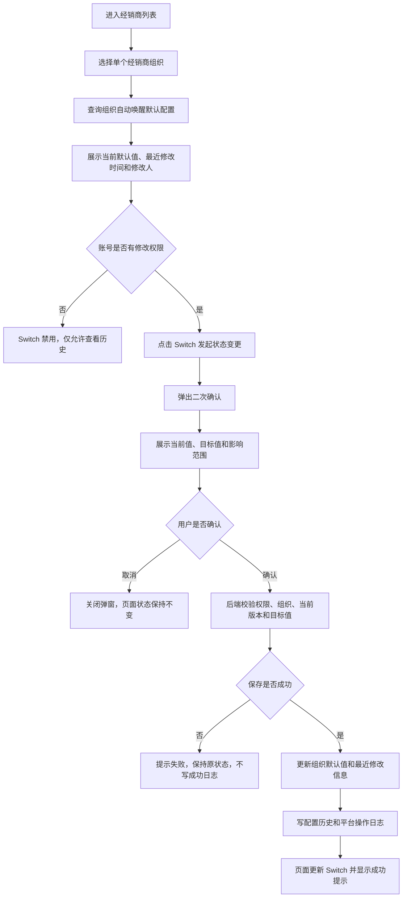
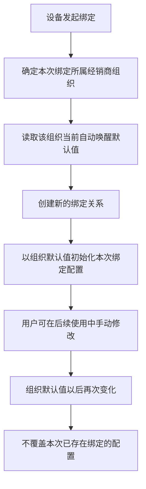
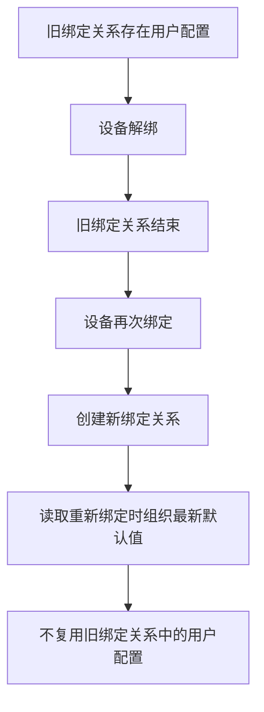

# 经销商设备默认参数配置需求文档

> 文档用途：产品、研发、测试需求宣讲与验收依据  
> 版本：V1.0  
> 更新时间：2026-09-29  
> 适用系统：设备中心平台 / 经销商列表  
> 需求状态：方案确认稿

## 1. 需求概述

### 1.1 背景

原自动唤醒配置依赖旧设备标签链路，链路老旧且已无人维护，需要由设备中心平台建立新的组织默认配置能力。

不同经销商对低功耗设备的出厂自动唤醒默认状态存在差异。平台需要支持按单个经销商组织维护“自动唤醒默认值”，并在设备建立新绑定关系时提供初始化默认值。

本需求只维护组织级默认配置，不承担设备控制、APP 入口权限控制或存量设备批量下发。

### 1.2 目标

1. 在现有“经销商列表 / 经销商详情”中维护每个组织的设备默认参数。
2. 默认值始终明确为“开启”或“关闭”，不存在第三种业务状态。
3. 修改前明确展示影响范围，避免运营人员误认为会修改存量设备。
4. 所有修改形成可追溯的只读历史记录和平台操作日志。
5. 为未来新绑定及解绑后重新绑定提供确定、可审计的初始化依据。

### 1.3 成功标准

- 有权限人员可以按单个组织查询、修改自动唤醒默认值。
- 修改组织默认值不会改变任何当前有效绑定设备的配置。
- 新绑定关系使用绑定时对应组织的最新默认值初始化。
- 解绑后重新绑定不恢复旧绑定期间的用户配置，而是使用组织最新默认值。
- 每次成功修改均可在历史抽屉和平台操作日志中追溯。

## 2. 名词定义

| 名词 | 定义 |
| --- | --- |
| 经销商组织 | 设备中心现有组织树中的单个经销商节点；一级、二级、三级使用同一套配置逻辑 |
| 组织默认值 | 当前经销商组织对应的自动唤醒初始化值，仅允许“开启”或“关闭” |
| 新绑定 | 创建新的设备绑定关系；包括设备首次绑定，以及解绑后再次绑定 |
| 当前绑定 | 尚未解除的有效设备绑定关系 |
| 用户手动配置 | 用户在绑定关系建立后主动修改的设备自动唤醒状态 |
| 历史补齐 | 研发根据旧系统导出的组织历史配置，直接补齐组织默认值及必要的初始化记录 |

## 3. 范围说明

### 3.1 本期范围

1. 按单个经销商组织维护自动唤醒默认值。
2. 在现有经销商详情中展示当前默认值、最近修改时间和最近修改人。
3. 使用 Switch 直接发起“开启 / 关闭”修改。
4. 修改前展示二次确认及影响范围。
5. 修改成功后更新页面状态、记录历史并写入操作日志。
6. 使用右侧抽屉查看组织级全部设备默认参数配置历史。
7. 旧系统历史配置由研发获取后手动补齐，不建设迁移任务模块。

### 3.2 明确不在本期范围

- 不新增一级菜单、独立页面或“自动唤醒管理”模块。
- 不支持一级组织向二级、三级组织批量覆盖或继承。
- 不支持多组织批量配置、导入、导出或批量同步。
- 不区分新组织和旧组织，所有组织使用同一套逻辑。
- 不维护 APP 是否展示自动唤醒入口。
- 不设计主账号、分享账号的入口权限编辑功能。
- 不向设备下发控制指令，不执行设备实时开关。
- 不修改当前已经绑定的设备配置。
- 不覆盖用户已经手动修改的设备配置。
- 不建设迁移任务、迁移进度或迁移失败重试页面。
- 历史记录不支持编辑、删除、回滚或审批。
- 本期修改默认值不需要审批；后续迭代再增加审批机制。

## 4. 用户角色与权限

| 角色 | 查看当前配置 | 修改配置 | 查看历史 | 说明 |
| --- | --- | --- | --- | --- |
| 有配置权限的平台账号 | 是 | 是 | 是 | 可以发起修改并完成二次确认 |
| 只读平台账号 | 是 | 否 | 是 | Switch 禁用，并展示无权修改提示 |
| 无组织数据权限账号 | 否 | 否 | 否 | 前后端均不得返回越权组织数据 |

权限要求：

1. 前端禁用或隐藏操作不能替代后端鉴权。
2. 查询和修改均需校验当前账号对目标组织的数据权限。
3. 修改请求中的组织 ID 不得由前端权限判断直接信任。
4. 直接修改 URL、重放请求或替换组织 ID 时，后端仍需拒绝越权访问。

## 5. 核心业务规则

### BR-01 配置维度

一个经销商组织对应一个自动唤醒默认值。一次只能修改一个组织，不支持向下级组织继承或覆盖。

### BR-02 默认值范围

默认值仅允许：

- `开启`
- `关闭`

页面不得出现“未配置”“待补齐”或空值作为业务状态。历史数据补齐前也必须由研发确定并写入明确值。

### BR-03 生效对象

组织默认值仅用于此后创建的新绑定关系。修改后：

- 当前已经绑定的设备：0 台受影响。
- 用户已经手动修改配置的设备：0 台受影响。
- 平台不会向任何现有设备发送控制指令。

### BR-04 用户配置优先级

设备完成绑定后，用户手动修改的配置优先级高于组织默认值。平台后续修改组织默认值不得覆盖该绑定关系中的用户配置。

### BR-05 解绑与重新绑定

解绑结束旧绑定关系。设备重新绑定时创建新的绑定关系：

- 不保留旧绑定关系中的用户手动配置。
- 使用重新绑定时所属组织的最新默认值初始化。

### BR-06 历史补齐

研发从旧系统获取组织历史配置后手动补齐：

- 不提供运营侧迁移任务模块。
- 不要求页面区分新旧组织。
- 补齐结果需保证每个组织均有明确的开启或关闭值。
- 若记录初始化历史，备注可标识“初始化历史配置”，但历史页面本期不展示备注列。

### BR-07 修改记录

仅保存成功后产生配置历史与平台操作日志。用户取消、权限失败、参数校验失败或保存失败，不得生成“成功”记录。

### BR-08 并发修改

若多人同时修改同一组织，平台应使用版本号、更新时间或等效机制识别旧数据提交。发生冲突时拒绝覆盖，并提示用户刷新后重试。

## 6. 全链路流程

### 6.1 查询与修改流程

### 6.2 绑定初始化流程

### 6.3 解绑重绑流程

## 7. 页面与交互需求

### 7.1 页面入口

路径：设备中心平台 → 经销商列表 → 选择组织 → 经销商详情。

设备默认参数配置区域位于经销商基础信息下方、详情 Tab 区域上方。不得改变左侧组织树、顶部导航、基础信息和已有 Tab 结构。

### 7.2 设备默认参数配置区域

展示内容：

| 字段 / 控件 | 要求 |
| --- | --- |
| 分组标题 | 设备默认参数配置 |
| 分组历史入口 | 位于分组标题右侧，点击打开该组织全部设备默认参数历史抽屉 |
| 自动唤醒参数卡片 | 作为分组下第一张独立卡片，标题为“自动唤醒默认值” |
| 说明 | 新绑定设备首次配置时，将使用该组织默认值。 |
| Switch | 位于自动唤醒卡片右上角，同时显示“开启 / 关闭”文字，不得只依赖颜色表达状态 |
| 当前默认值 | 使用开启或关闭状态标签展示 |
| 最近修改 | 展示最近修改时间和修改人；卡片内不再放置历史入口 |
| 其他参数卡片 | 仅当参数存在有效配置值时展示；未配置、空值不展示，不展示占位卡片；`关闭`、`false`均属于有效值 |

展示规则：

1. 分组标题为普通标题行，不增加额外的外层大卡片，避免卡片嵌套。
2. 当前暂无其他有效参数时，页面仅展示自动唤醒卡片，不展示“暂无其他配置”等占位内容。
3. 后续新增其他设备默认参数时，与自动唤醒卡片保持同级展示，并复用分组级历史入口。

交互要求：

1. 用户点击 Switch 时，Switch 不得先行乐观切换。
2. 必须先打开二次确认弹窗；取消后保持原值。
3. 保存成功后再更新 Switch、默认值、修改时间和修改人。
4. 保存失败后保持原值，并展示明确的失败提示。
5. 只读账号的 Switch 禁用，同时展示“当前账号无权修改组织设备默认配置”。

### 7.3 二次确认弹窗

弹窗标题根据目标值展示：

- 确认开启自动唤醒默认值？
- 确认关闭自动唤醒默认值？

必须展示：

1. 当前组织名称和组织 ID。
2. 当前默认值与修改后默认值。
3. 生效对象：未来在当前组织下新绑定的设备。
4. 预计影响数量：暂无预测能力时显示“无法预估，以实际新绑定数量为准”。
5. 当前已绑定设备数量，以及本次影响 0 台。
6. 已产生用户手动配置的设备数量（数据可提供时），以及本次影响 0 台。
7. 生效时机：设备首次绑定时。
8. 应用方式：使用新的组织默认值初始化。
9. 不会影响列表：现有设备、当前使用状态、用户手动配置。
10. 明确说明不会下发设备控制指令。
11. 重新绑定规则：解绑后再次绑定使用组织最新默认值。

按钮：

- 取消：关闭弹窗，不发起保存，不写日志。
- 确认开启 / 确认关闭：执行保存；请求处理期间需防止重复提交。

### 7.4 设备默认参数配置历史抽屉

抽屉为右侧只读抽屉，不跳转新页面。

头部：

- 标题：设备默认参数配置历史。
- 副标题：经销商名称（组织 ID）。
- 右上角关闭按钮。

表格字段：

| 字段 | 说明 |
| --- | --- |
| 操作时间 | 成功保存的时间，按时间倒序 |
| 参数项 | 被修改的设备默认参数名称，例如“自动唤醒默认值” |
| 操作人 | 平台账号显示名称 |
| 修改前 | 开启或关闭；初始化记录可为“-” |
| 修改后 | 开启或关闭 |
| 操作结果 | 本期成功记录展示“成功”标签 |

分页要求：

- 展示总记录数。
- 支持 10 条 / 页和 20 条 / 页。
- 支持上一页、当前页和下一页。
- 首页时上一页禁用，末页时下一页禁用。
- 切换每页条数后回到第 1 页。

空状态：无历史时展示“暂无历史记录”，不得显示空表格或报错。

## 8. 数据与接口约束

以下为研发联调约定，具体接口路径以现有设备中心接口规范为准。

### 8.1 查询组织默认配置

输入：

- 组织 ID。

返回至少包含：

| 字段 | 类型 | 说明 |
| --- | --- | --- |
| organizationId | String | 经销商组织 ID |
| defaultValue | Enum | `on` / `off` |
| updatedAt | DateTime | 最近修改时间 |
| updatedBy | String | 最近修改人 |
| version | String / Number | 并发控制版本 |
| boundDeviceCount | Number | 当前已绑定设备数，可不可用时需明确返回策略 |
| userConfiguredDeviceCount | Number | 用户手动配置设备数，可不可用时需明确返回策略 |
| canEdit | Boolean | 当前账号是否可编辑；后端仍需在保存时重新鉴权 |

### 8.2 修改组织默认配置

输入至少包含：

- 组织 ID。
- 目标默认值 `on` / `off`。
- 当前版本号或等效并发校验字段。
- 幂等键或等效防重复机制。

处理要求：

1. 校验账号权限和组织数据范围。
2. 校验目标值只能为 `on` 或 `off`。
3. 新值与当前值相同时按无变更处理，不重复写历史。
4. 校验并发版本，拒绝旧版本覆盖。
5. 默认值更新、配置历史和平台操作日志应保持事务一致性或具备等效补偿方案。

返回至少包含：最新默认值、最新修改时间、修改人和新版本号。

### 8.3 查询配置历史

输入：组织 ID、页码、每页条数。

返回：总数、当前页、每页条数和历史记录列表。记录按操作时间倒序；每条记录至少包含参数项名称、参数项标识、操作人、操作时间、修改前值、修改后值和操作结果。

## 9. 日志与审计

每次成功修改至少记录：

- 组织 ID、组织名称。
- 操作类型：修改自动唤醒默认值。
- 修改前值、修改后值。
- 操作人账号 ID 与显示名称。
- 操作时间。
- 操作来源：设备中心平台。
- 操作结果。
- 请求或链路追踪 ID（平台具备时）。
- 说明：仅影响未来新绑定设备。

失败请求是否写安全或系统日志由研发按平台规范处理，但不得混入用户可见的成功配置历史。

## 10. 页面状态与异常处理

| 场景 | 页面行为 |
| --- | --- |
| 配置加载中 | 保持卡片尺寸稳定，Switch 不可操作 |
| 配置加载失败 | 展示加载失败及重试入口，不得默认展示“关闭”误导用户 |
| 无查看权限 | 不展示目标组织配置数据，返回标准无权限状态 |
| 无修改权限 | 展示当前值，Switch 禁用，仍可按权限查看历史 |
| 保存处理中 | 确认按钮进入处理中状态，禁止重复提交 |
| 保存失败 | 关闭或保留弹窗按项目规范执行；必须保留原值并提示失败原因 |
| 并发冲突 | 提示“配置已被其他人修改，请刷新后重试”，不得覆盖新值 |
| 历史为空 | 展示明确空状态 |
| 历史加载失败 | 展示失败提示和重试入口，不影响主卡片配置查询 |

## 11. 研发实现拆分建议

### 11.1 前端

- 在现有经销商详情中接入配置查询。
- 实现当前值展示、权限禁用态、二次确认和保存反馈。
- 实现只读历史抽屉、分页、空状态和加载失败状态。
- 防止用户取消时 Switch 发生视觉残留切换。
- 保持其他模块结构和样式不变。

### 11.2 后端

- 提供组织默认配置查询与单组织修改能力。
- 提供历史分页查询。
- 完成组织范围鉴权、参数校验、并发控制和幂等保护。
- 保证配置、历史与操作日志的一致性。
- 为绑定初始化链路提供组织最新默认值读取能力。

### 11.3 数据处理

- 获取旧系统已定制的组织历史配置。
- 由研发脚本或人工方式补齐，不建设迁移任务页面。
- 补齐前校验组织映射、默认值合法性和重复数据。
- 补齐后输出组织总数、成功数、失败数及失败原因，供内部核对。

### 11.4 测试

- 覆盖页面、接口、权限、数据范围、并发、幂等、绑定生命周期和历史审计。
- 验证修改默认值前后，存量设备配置数据完全不变。
- 验证解绑重绑使用最新默认值，而非旧用户配置。

## 12. 验收标准

### 12.1 功能与交互验收

| 编号 | 验收场景 | 前置条件 | 操作 | 预期结果 |
| --- | --- | --- | --- | --- |
| AC-01 | 展示组织配置 | 组织默认值为开启 | 进入组织详情 | 显示开启；Switch、当前默认值、最近修改时间和修改人一致 |
| AC-02 | 关闭状态展示 | 组织默认值为关闭 | 切换至该组织 | 显示关闭，且文字明确，不仅通过颜色表达 |
| AC-03 | 发起开启 | 当前值为关闭且有修改权限 | 点击 Switch | 不立即改变当前值；打开“确认开启自动唤醒默认值？”弹窗 |
| AC-04 | 发起关闭 | 当前值为开启且有修改权限 | 点击 Switch | 不立即改变当前值；打开“确认关闭自动唤醒默认值？”弹窗 |
| AC-05 | 取消修改 | 已打开确认弹窗 | 点击取消或关闭 | 不发起保存；Switch 保持原值；不生成配置历史和成功操作日志 |
| AC-06 | 成功修改 | 保存接口成功 | 点击确认 | 更新 Switch、当前值、最近修改时间和修改人；显示成功提示 |
| AC-07 | 保存失败 | 保存接口失败 | 点击确认 | 页面保持原值；展示失败提示；不产生成功历史 |
| AC-08 | 防重复提交 | 保存请求处理中 | 连续点击确认 | 最多产生一次有效修改和一条成功历史 |
| AC-09 | 无变化提交 | 当前值与目标值相同 | 构造重复请求 | 后端不重复更新、不新增历史 |
| AC-10 | 确认内容完整 | 打开确认弹窗 | 检查内容 | 包含当前值、目标值、影响范围、0 台存量受影响、不下发设备指令和重绑规则 |
| AC-10a | 参数卡片展示 | 组织仅配置自动唤醒默认值 | 进入组织详情 | 展示“设备默认参数配置”分组和自动唤醒独立卡片；不展示其他参数占位内容 |
| AC-10b | 有效值识别 | 其他参数值为“关闭”或 `false` | 进入组织详情 | 对应参数卡片正常展示，不被识别为空配置 |

### 12.2 数据生命周期验收

| 编号 | 验收场景 | 操作 | 预期结果 |
| --- | --- | --- | --- |
| AC-11 | 仅影响未来新绑定 | 修改组织默认值 | 修改前已绑定设备的自动唤醒状态均不变化 |
| AC-12 | 用户配置不覆盖 | 用户已手动修改设备状态后，平台修改组织默认值 | 该绑定关系中的用户状态不变化 |
| AC-13 | 新绑定初始化 | 组织默认值为开启时创建新绑定 | 新绑定初始化值为开启 |
| AC-14 | 修改后的新绑定 | 将组织默认值由开启改为关闭，再创建新绑定 | 新绑定初始化值为关闭；修改前绑定仍保持原状态 |
| AC-15 | 解绑重绑 | 设备旧绑定中用户改为开启；解绑；组织默认值为关闭；重新绑定 | 新绑定初始化为关闭，不恢复旧绑定的开启状态 |
| AC-16 | 组织互不影响 | 修改组织 A 默认值 | 组织 B、C 的默认值和历史均不变化 |
| AC-17 | 无上下级覆盖 | 修改一级组织默认值 | 所有二级、三级组织默认值均不变化 |

### 12.3 历史与审计验收

| 编号 | 验收场景 | 操作 | 预期结果 |
| --- | --- | --- | --- |
| AC-18 | 打开历史抽屉 | 点击分组标题右侧查看历史 | 右侧打开“设备默认参数配置历史”，副标题展示组织名称和 ID；自动唤醒卡片内无独立历史入口 |
| AC-19 | 历史字段 | 查看有记录组织 | 表格展示操作时间、参数项、操作人、修改前、修改后、操作结果 |
| AC-20 | 历史排序 | 组织存在多条记录 | 打开抽屉 | 记录按操作时间倒序，最新记录在首行 |
| AC-21 | 历史一致性 | 成功修改一次 | 打开历史及平台操作日志 | 两处均可查到一致的组织、前后值、操作人和时间 |
| AC-22 | 历史分页 | 历史超过 10 条 | 翻页并切换每页条数 | 总数、页码、10/20 条每页、上一页/下一页状态正确 |
| AC-23 | 历史空状态 | 组织无历史记录 | 打开抽屉 | 展示“暂无历史记录”，页面无报错 |
| AC-24 | 历史只读 | 打开历史抽屉 | 检查所有操作 | 不存在编辑、删除、回滚、审批或迁移按钮 |

### 12.4 权限与安全验收

| 编号 | 验收场景 | 操作 | 预期结果 |
| --- | --- | --- | --- |
| AC-25 | 只读账号 | 进入有权查看的组织 | 可查看当前值和历史；Switch 禁用；有明确无权修改提示 |
| AC-26 | 直接调用修改接口 | 只读账号绕过前端调用接口 | 后端拒绝，配置及历史不变化 |
| AC-27 | 组织越权 | 将请求组织 ID 替换为无权限组织 | 查询和修改均被拒绝，不泄露目标组织数据 |
| AC-28 | 并发冲突 | A、B 同时读取；A 先保存；B 用旧版本保存 | B 被拒绝并提示刷新，不覆盖 A 的结果 |
| AC-29 | 非法枚举值 | 提交非 `on` / `off` 值 | 后端参数校验失败，不更新、不写成功历史 |

### 12.5 兼容与质量验收

| 编号 | 验收场景 | 预期结果 |
| --- | --- | --- |
| AC-30 | 页面回归 | 左侧组织树、经销商基础信息、设备测试记录、APP 测试账号、操作日志及导航行为不受影响 |
| AC-31 | 键盘操作 | Switch、弹窗按钮、历史入口、抽屉关闭和分页可通过键盘聚焦与操作 |
| AC-32 | 状态可识别 | 开启、关闭、成功和禁用状态均同时有文字，不仅依赖颜色 |
| AC-33 | 响应式布局 | 常用桌面分辨率下无文字遮挡、列截断或控件重叠；窄屏时允许表格区域内部滚动 |
| AC-34 | 性能 | 切换组织不会重复发起无效请求；历史使用分页，不一次性加载全部记录 |
| AC-35 | 历史数据补齐 | 补齐脚本执行后 | 所有目标组织均有明确默认值；成功、失败及失败原因可核对；页面无需展示迁移任务 |

## 13. 测试数据建议

至少准备以下组织与设备数据：

1. 默认开启、存在多条历史的组织。
2. 默认关闭、无历史的组织。
3. 一级、二级、三级组织各一个，默认值相互不同。
4. 有已绑定设备且有用户手动配置记录的组织。
5. 有权限、只读、无组织权限三类平台账号。
6. 可执行解绑和重新绑定的测试设备。
7. 可模拟保存失败、历史加载失败和并发冲突的测试条件。

## 14. 上线前检查

- 旧系统目标组织配置已完成提取和内部核对。
- 默认值补齐完成，不存在空值或非法值。
- 前端权限状态与后端权限校验一致。
- 修改接口具备幂等与并发保护。
- 配置、历史、平台操作日志的一致性已验证。
- 存量设备配置前后对比结果为零变化。
- 新绑定和解绑重绑链路已完成端到端验证。
- 历史抽屉分页、空状态和异常状态已验证。
- 未新增独立菜单、迁移任务或设备控制链路。
- 后续审批能力作为独立迭代评审，不阻塞本期上线。

## 15. 待研发测试宣讲时确认

以下问题不改变当前产品边界，但需要在开发联调前形成明确结论：

1. 组织默认配置和绑定初始化分别由哪个服务负责，读取失败时是否阻断绑定。
2. `boundDeviceCount` 与 `userConfiguredDeviceCount` 的统计口径、实时性和不可用时的页面展示。
3. 并发控制采用版本号、更新时间还是数据库乐观锁。
4. 配置更新、历史记录和平台操作日志的一致性保障方案。
5. 历史补齐脚本的执行环境、回滚方案和核对人。
6. 测试环境如何模拟新绑定、解绑重绑及用户手动配置。
