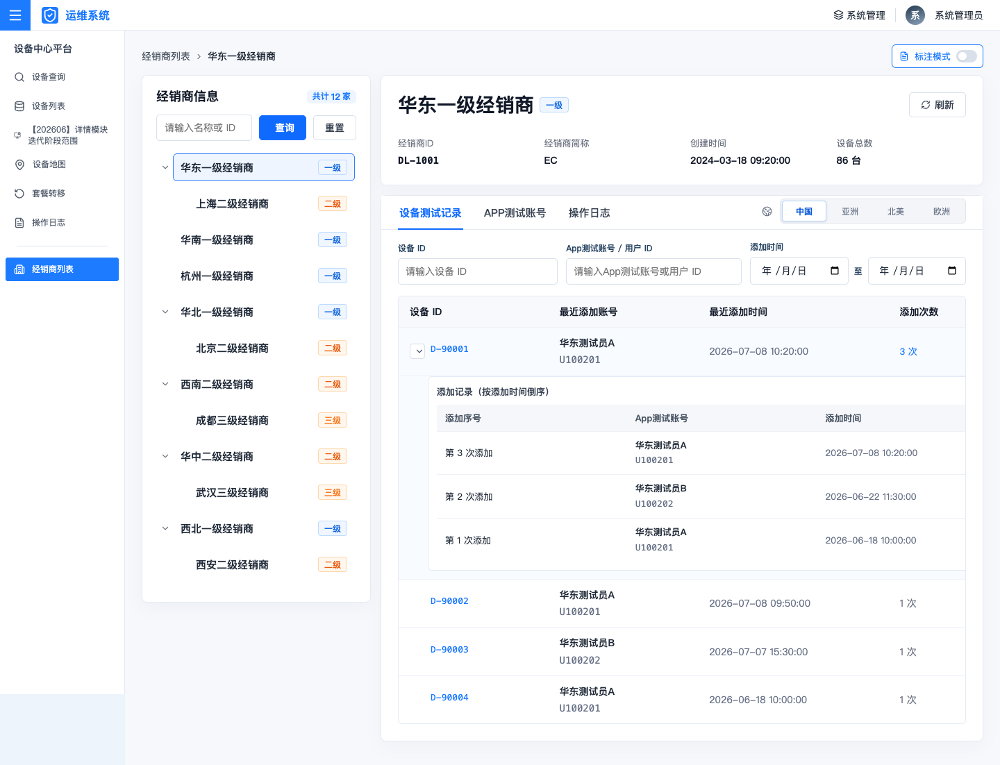
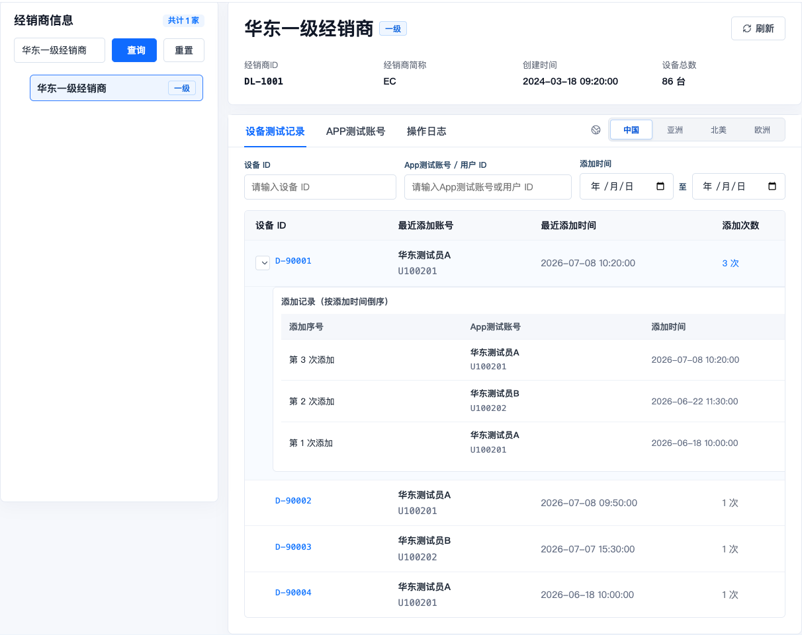
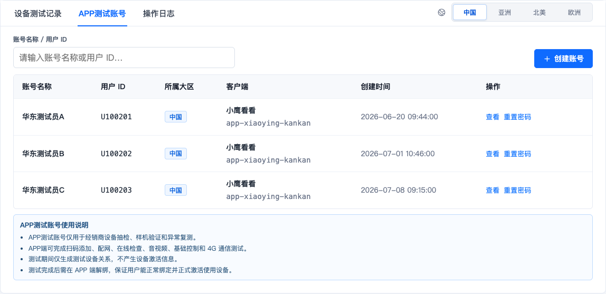
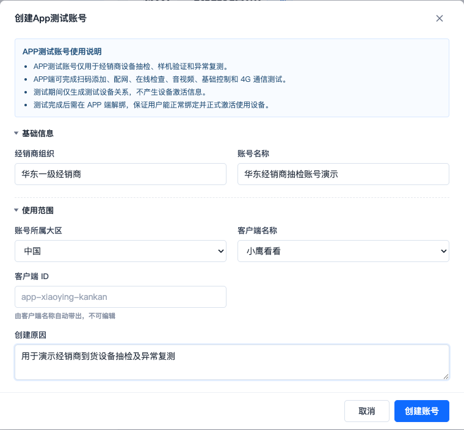
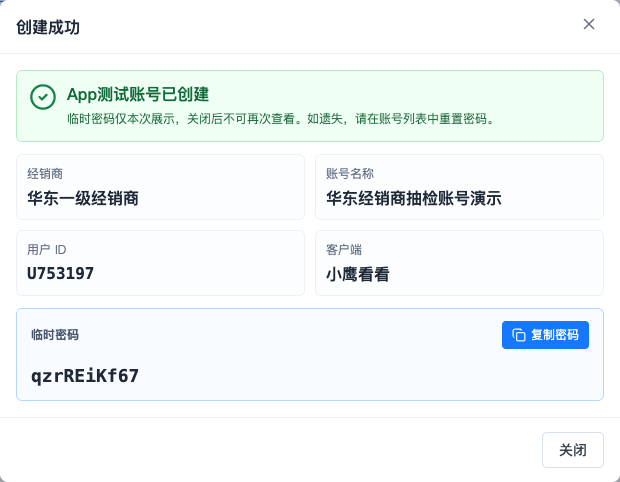
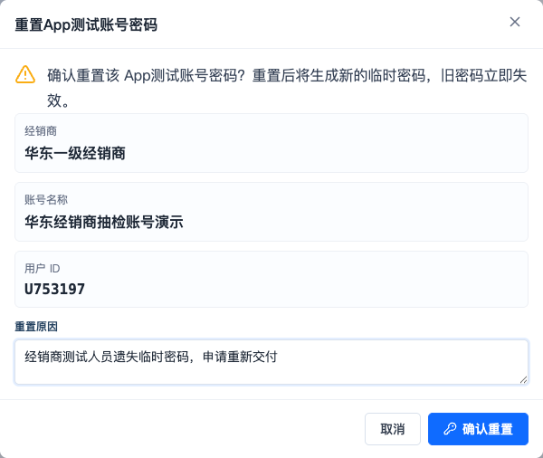
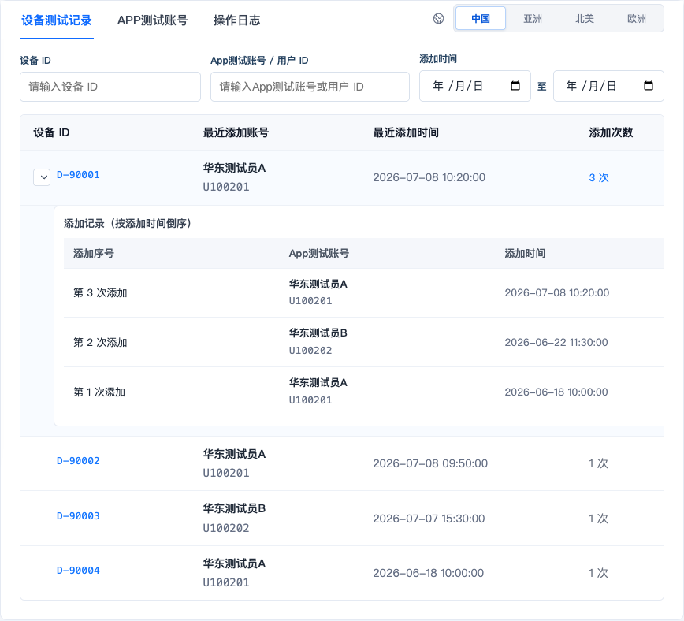
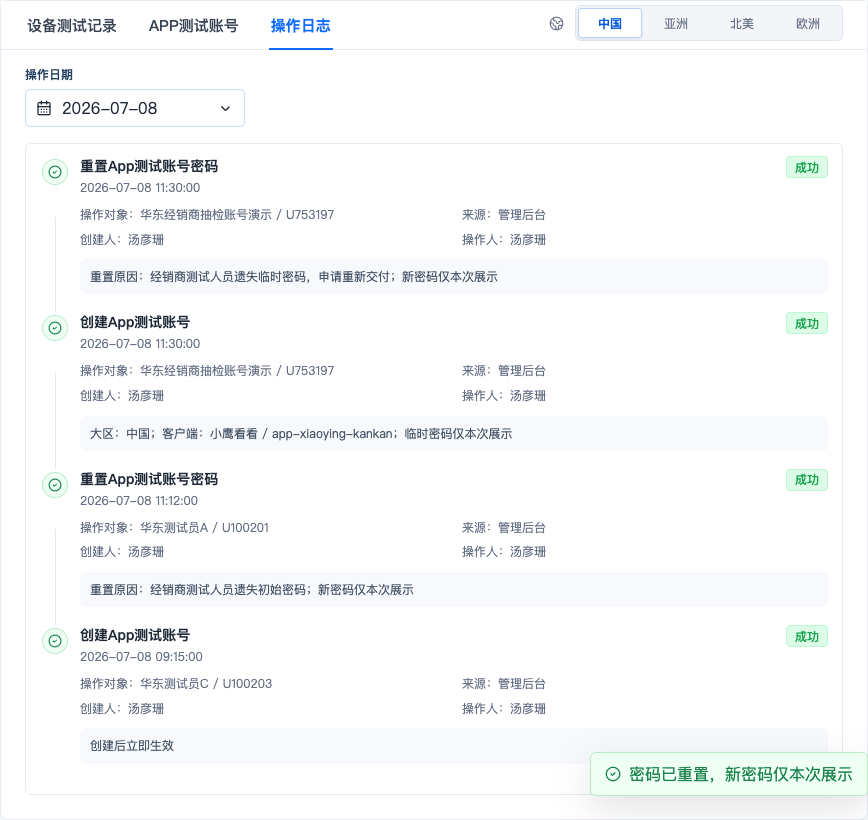

# 经销商列表：APP 测试账号操作指南

> 钉钉复制说明：可直接复制本文件正文到钉钉文档。若需要同时保留截图，请打开局域网 HTML 手册，点击页面右上角“复制到钉钉”，再粘贴到钉钉文档。

**适用人员：** 跟单管理人员、平台运营人员  
**功能范围：** 设备中心 > 经销商列表  
**文档用途：** 指导跟单人员为经销商创建和维护 APP 测试账号，并查询设备测试记录及后台操作日志  
**截图说明：** 本文截图使用演示数据，实际经销商、用户 ID、时间和临时密码以页面显示为准

---

## 一、APP 测试账号是做什么的

APP 测试账号是提供给经销商测试人员使用的专用账号，主要用于：

1. 经销商收到设备后进行抽样检查。
2. 样机交付前验证设备是否可以正常使用。
3. 设备出现异常后进行复测。
4. 在 APP 中完成扫码添加、配网、上线检查、音视频、基础控制和 4G 通信测试。

### 它解决了什么问题

以前，经销商为了验货而在 APP 中添加设备，可能被系统当成真实用户首次激活，从而提前写入激活时间、消耗云存或流量权益，并影响真实激活统计。

使用 APP 测试账号后，系统只建立临时的测试设备关系，不把抽检行为当成正式销售和正式激活。

| 经销商测试时 | 系统处理结果 |
|---|---|
| 扫码添加设备 | 建立测试关系，设备可用于约定的基础测试 |
| 设备正式激活 | 不触发 |
| 首次激活时间 | 不写入 |
| 正式云存权益 | 不生效、不提前消耗 |
| 正式流量套餐 | 不生效、不提前消耗 |
| 真实激活统计 | 不计入 |
| 测试结束 | 经销商测试人员需要在 APP 端解绑设备 |

**特别说明：** “设备反激活”不是先激活再回退，而是在正式激活发生前识别测试账号并阻止正式激活。

---

## 二、跟单人员与经销商测试人员的分工

| 角色 | 主要工作 |
|---|---|
| 跟单管理人员 | 查找经销商、创建 APP 测试账号、安全交付临时密码、重置密码、查询设备测试记录和操作日志 |
| 经销商测试人员 | 使用测试账号登录 APP、扫码添加设备、完成设备测试、测试结束后在 APP 端解绑设备 |

跟单人员负责“账号和记录”，经销商测试人员负责“实际测试和解绑”。

---

## 三、完整使用流程

1. 跟单人员确认经销商名称、所属大区和需要使用的 APP 客户端。
2. 在“经销商列表”中查询并选中经销商。
3. 进入“APP 测试账号”标签，先检查是否已有可用账号。
4. 没有合适账号时创建新账号。
5. 创建成功后，将账号名称、客户端和临时密码安全交付给经销商测试人员。
6. 经销商测试人员登录 APP，扫码添加设备并完成测试。
7. 跟单人员可在“设备测试记录”中查询设备添加情况。
8. 测试完成后，经销商测试人员必须在 APP 端解绑设备。
9. 如需追溯后台操作，在“操作日志”中按日期查询。

---

## 四、进入页面并认识页面布局

进入路径：**设备中心 > 经销商列表**。

页面主要分为两部分：

- 左侧“经销商信息”：查询和选择经销商。
- 右侧“经销商详情”：查看设备测试记录、APP 测试账号和操作日志。

右侧页面上方的大区选项包括：中国、亚洲、北美、欧洲。

**大区会同时影响以下三个标签的数据：**

- 设备测试记录
- APP 测试账号
- 操作日志

因此，查询不到账号或记录时，应先检查当前选择的大区是否正确。

---

## 五、操作一：查询并选择经销商

1. 在左侧“经销商名称 / ID”输入框中输入经销商名称或经销商 ID。
2. 点击“查询”。
3. 在查询结果中点击目标经销商。
4. 核对右侧的经销商名称、经销商 ID、简称、创建时间和设备总数。

### 查询说明

- 经销商名称支持模糊查询。
- 经销商 ID 支持直接查询，例如 `DL-1001`。
- 点击“重置”可清空查询条件并恢复全部经销商。
- 查询结果变化后，右侧详情会显示当前选中的经销商。

---

## 六、操作二：查看和查询 APP 测试账号

1. 先在右上方选择正确的大区。
2. 点击“APP 测试账号”标签。
3. 在“账号名称 / 用户 ID”中输入关键词，即可筛选账号。
4. 核对账号名称、用户 ID、所属大区、客户端和创建时间。

列表中的操作说明：

| 操作 | 用途 |
|---|---|
| 查看 | 打开用户中心详情，用于进一步核对账号信息 |
| 重置密码 | 账号密码遗失或需要重新交付时生成新密码 |

**当前页面暂不提供：** 账号有效期、权限状态、启用、停用、延期和审批操作。不要在本页面中寻找这些入口。

---

## 七、操作三：创建 APP 测试账号

### 创建前先确认

- 经销商选择正确。
- 经销商当前允许创建账号；停用经销商只能查看，不能创建。
- 所属大区正确。
- 客户端正确，目前可选“小鹰看看”或“小鹰视界”。
- 已确认现有账号中没有合适账号，避免重复创建。

### 创建步骤

1. 在“APP 测试账号”标签中点击“创建账号”。
2. 核对系统自动带入的经销商组织。
3. 填写账号名称。
4. 选择账号所属大区。
5. 选择客户端名称，客户端 ID 会自动带出，不需要手动填写。
6. 填写创建原因，例如“用于到货设备抽检和异常复测”。
7. 点击“创建账号”。

### 字段填写规则

| 字段 | 是否必填 | 填写要求 |
|---|---|---|
| 经销商组织 | 是 | 系统自动带入当前经销商，只读，不可修改 |
| 账号名称 | 是 | 建议包含经销商或使用场景；同一经销商下不能重名 |
| 账号所属大区 | 是 | 可选中国、亚洲、北美、欧洲 |
| 客户端名称 | 是 | 选择“小鹰看看”或“小鹰视界” |
| 客户端 ID | 是 | 系统根据客户端名称自动带出，不可编辑 |
| 创建原因 | 是 | 简要说明抽检、样机验证或异常复测用途，最多 200 字 |

### 创建成功后如何处理临时密码

创建成功后，页面会显示账号名称、用户 ID、客户端和临时密码。

临时密码规则：

- 共 10 位。
- 只包含大写字母、小写字母和数字。
- 三类字符至少各有 1 位。
- 仅在创建成功弹窗中显示一次。
- 关闭弹窗后不能再次查看。

**交付要求：**

1. 点击“复制密码”。
2. 将账号名称、所属客户端和临时密码通过一对一的安全方式交付给指定测试人员。
3. 用户 ID 建议留存，便于后续在后台查询和追溯。
4. 不要把真实临时密码写入操作指南、公开群聊、工单备注或共享表格。
5. 确认信息已正确交付后，再关闭成功弹窗。

截图中的密码只用于演示，不可作为实际登录密码使用。

---

## 八、操作四：重置 APP 测试账号密码

适用场景：临时密码遗失、测试人员无法登录，或需要重新交付账号。

1. 进入目标经销商的“APP 测试账号”标签。
2. 选择正确的大区。
3. 找到目标账号，点击“重置密码”。
4. 核对经销商、账号名称和用户 ID。
5. 填写重置原因，说明为什么需要重置。
6. 点击“确认重置”。

重置成功后：

- 旧密码立即失效。
- 新密码只展示一次，展示方式与创建成功弹窗一致。
- 需要重新将新密码安全交付给指定测试人员。
- 重置操作及原因会写入操作日志。
- 重置密码不会改变经销商组织或账号的可用状态。

---

## 九、操作五：查看设备测试记录

“设备测试记录”用于查看当前经销商、当前大区下，测试账号添加过哪些设备。

1. 选择正确的大区。
2. 点击“设备测试记录”标签。
3. 可按设备 ID 查询。
4. 可按 APP 测试账号或用户 ID 查询。
5. 可选择添加时间范围。
6. 点击设备 ID 或“查看设备详情”，可进入设备详情继续核对。
7. 当“添加次数”大于 1 时，点击次数或展开按钮查看历史添加记录。

### 记录说明

- 每个设备 ID 在主表中只显示一行。
- 主表显示最近添加账号、最近添加时间和累计添加次数。
- 展开后按添加时间倒序显示每次添加记录。
- 账号和时间筛选以该设备的最近一次添加记录为准。

---

## 十、操作六：查看操作日志

“操作日志”用于追溯后台人员对当前经销商所做的操作。

1. 选择正确的大区。
2. 点击“操作日志”标签。
3. 点击“操作日期”，选择需要查询的日期。
4. 查看操作类型、操作对象、来源、创建人、操作人、结果和备注。

### 日志说明

- 页面默认显示当前选中日期的日志。
- 日历中只有存在操作日志的日期可以点击；无日志日期会置灰。
- 可记录创建 APP 测试账号、重置密码、手动清理和重试清理等后台操作。
- 复制临时密码不会写入操作日志。
- APP 端测试绑定和主动解绑不在此后台操作日志中记录。

---

## 十一、完整场景演示

以下以“华东一级经销商需要新增一个到货抽检账号”为例：

1. 在左侧输入“华东一级经销商”，点击“查询”。
2. 点击查询结果，确认右侧经销商 ID 为目标组织。
3. 选择“中国”大区。
4. 进入“APP 测试账号”，先搜索确认没有合适账号。
5. 点击“创建账号”。
6. 账号名称填写“华东经销商抽检账号”，客户端选择“小鹰看看”。
7. 创建原因填写“用于到货设备抽检及异常复测”。
8. 提交后复制临时密码，与账号名称、客户端一起安全交付指定测试人员。
9. 经销商测试人员登录 APP，扫码添加设备并完成配网、上线、音视频、控制或 4G 通信测试。
10. 跟单人员在“设备测试记录”中按设备 ID 或账号查询添加情况。
11. 测试结束后，提醒测试人员在 APP 端解绑设备。
12. 返回“操作日志”，确认账号创建记录；如发生密码重置，同时核对重置原因和结果。

完成以上步骤，即形成“账号创建、密码交付、设备测试、APP 解绑、后台追溯”的完整闭环。

---

## 十二、常见问题

### 1. “创建账号”按钮是灰色，不能点击

该经销商可能已停用。停用经销商仍可查看详情，但不能创建 APP 测试账号。请先核对经销商状态并联系对应管理人员处理。

### 2. 提示“该经销商下已存在同名 APP 测试账号”

先在账号列表中查询现有账号。如确需新建，请修改账号名称，保证同一经销商下名称不重复。

### 3. 创建后在列表中找不到账号

依次检查：

1. 当前选择的大区是否与创建时一致。
2. 账号名称或用户 ID 查询条件是否仍然存在。
3. 当前选中的经销商是否正确。

创建成功后，页面会自动切换到新账号所属大区和“APP 测试账号”标签。

### 4. 临时密码忘记保存或交付失败

临时密码关闭后无法再次查看。请在账号列表中点击“重置密码”，填写原因并生成新密码，不要尝试找回旧密码。

### 5. 设备测试记录查询不到

先检查经销商、大区、设备 ID、账号关键词和添加时间范围。账号与时间条件只匹配设备最近一次添加记录。

### 6. 测试账号无法添加某台设备

已正式激活或已有正式用户关系的设备不能再建立测试绑定。请核对设备状态，避免影响真实用户关系。

### 7. 测试结束后为什么还要在 APP 端解绑

解绑可以结束临时测试关系，确保真实用户后续能够正常绑定并完成正式激活。后台查看记录不能代替 APP 端解绑。

---

## 十三、重要注意事项

1. APP 测试账号只用于设备抽检、样机验证和异常复测，不作为真实消费者账号使用。
2. 测试账号禁止分享或转移设备，也不能兑换正式云存权益。
3. 测试完成后必须在 APP 端解绑设备。
4. 临时密码只展示一次，交付前不要关闭弹窗。
5. 真实密码不得写入共享文档、公开群聊或工单备注。
6. 账号创建和密码重置需要填写真实、清楚的原因，便于后续审计。
7. 查询账号、设备记录和日志前，先确认经销商与大区。
8. 当前页面没有账号审批、有效期、启停或延期功能。

---

## 十四、操作完成检查清单

| 检查项 | 完成 |
|---|---|
| 已确认目标经销商和经销商 ID | □ |
| 已确认账号所属大区 | □ |
| 已确认 APP 客户端 | □ |
| 已检查现有账号，避免重复创建 | □ |
| 账号名称符合命名要求且未重名 | □ |
| 创建原因填写清楚 | □ |
| 临时密码已通过安全方式交付指定人员 | □ |
| 用户 ID 已留存，便于后续查询 | □ |
| 已告知测试人员测试完成后在 APP 端解绑 | □ |
| 如有密码重置，已核对操作日志 | □ |
